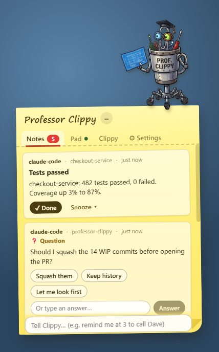
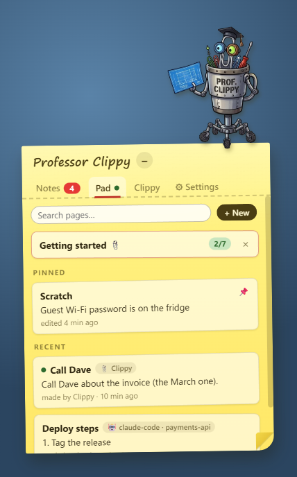
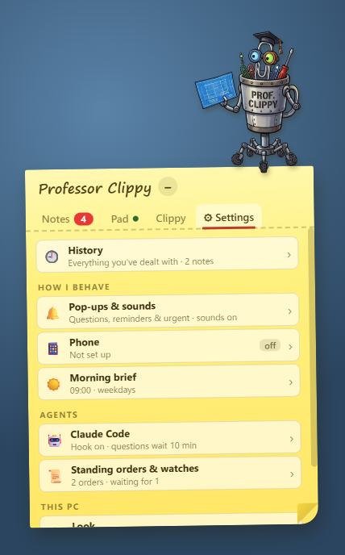
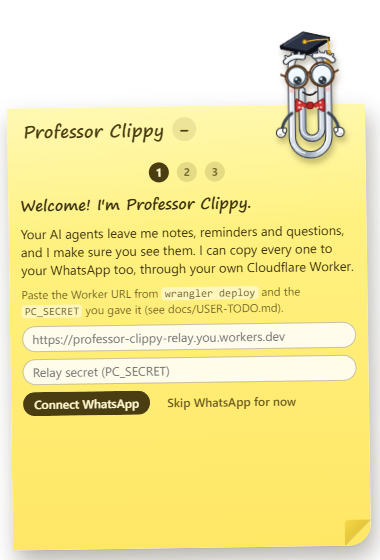
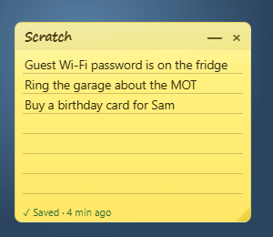

# Professor Clippy

**[⬇ Download for Windows](https://github.com/geetbatth/professor-clippy/releases/latest)** · [what you need](#requirements)

A Windows desktop sticky note with a robot professor standing on it: Professor Clippy is a riveted
steel canister stencilled "PROF. CLIPPY", with a paperclip head in mismatched goggles and a
mortarboard, robot arms and caster wheels. Your AI agents (Claude Code and
any other MCP client on this PC) leave him notes, reminders and questions; he pops up, wiggles,
and waits until you deal with them. He is quiet by default: he only pops up for questions,
reminders and urgent things (Settings → Pop-ups & sounds → Pop up for → Everything changes that); other notes wait
under his unread badge. Notes and questions are mirrored to your WhatsApp and/or Telegram once
you have been away from the PC for a few minutes (Settings → Phone → Send to my phone → Always sends them
at once), and you can answer, or just chat with him, from your phone. When you go away, only notes
that have waited less than an hour are sent; older ones stay on the desk.

   

- **Agents talk to Clippy through an MCP server** (`clippy`): `leave_message`, `remind_me`
  (ISO time, optional RRULE), `ask_user` (blocks until you answer, 10 minutes by default),
  `check_reply`, `list_reminders`, `cancel_reminder`, `list_pending_asks`, `answer_pending`,
  and the Pad tools `write_page`, `read_page` and `list_pages` (below; `archive_page` is Clippy's
  alone).
- **A Claude Code hook** leaves a note when an agent finishes or needs your permission.
  "Agent finished" notes only interrupt you when you have been away from the PC (no keyboard or
  mouse input) for a while: Settings → Phone → "I count as away after N
  min" (default 3; 0 = always). While you are at the PC they go quietly into History, with no
  pop-up, sound or WhatsApp/Telegram message. Permission requests always come through.
- **Tell Clippy** is a one-line box under the notes (and a global hotkey, default
  **Ctrl+Alt+Space**, Settings → Windows & hotkeys → "Tell Clippy hotkey"; empty = off). Press it from any app, type
  "remind me at 3 to call Dave" and Enter; his reply shows under the box (× clears it). Escape
  tucks him away again. It is the same conversation as the **Clippy** tab. If the hotkey is
  taken by another app, Settings says so.
- **Clippy's own chat brain** is Claude Code running headless with your Claude Code login (no
  API key). It can read files and search the web, manage your messages and reminders, and
  answer agents' questions for you; it cannot edit files or run commands (beyond asking to restart
  an app or the PC, below). Of the `clippy` tools
  it gets all but `ask_user` and `check_reply` (a brain turn waiting for your answer would hold
  up every chat turn behind it), so when it needs something from you it simply asks in its reply.
  It also has fifteen tools no agent sees: `list_notes`, `recent_activity`, `snooze_note`,
  `dismiss_note`, `set_look` (colour themes, below), `archive_page` and the standing-order, watch and restart tools below. Tell him "not now, bring it back after
  lunch" and he snoozes the newest unread note; ask "what happened while I was at lunch?" or
  "what's waiting on me?" and he summarises.
- **The Pad** is a set of pages you keep (a scratch page, a shopping list, a call to make), unlike
  notes, which you dismiss. Clippy writes them for you ("jot down: call Dave about the invoice",
  "add milk to my shopping page", "what did I write about the deploy?"), and agents can leave
  you one to keep, such as a checklist or a summary, with `write_page` (`read_page` and `list_pages`
  read them; only Clippy can `archive_page`). An agent can only change the pages it wrote itself;
  yours, and other agents', are refused (asked for by title, it only finds its own, and starts its
  own page if it has none), while Clippy can change any page. Any connected agent can read every
  page on the Pad with `read_page` and `list_pages`, so don't keep secrets there. If Clippy or an agent changes a
  page while you are typing in it, your save is refused rather than overwriting theirs (so nothing
  is silently lost). A page written by someone else counts as new until you open it. Pages nobody
  has changed for 30 days are archived (not pinned ones, or ones popped out on the desktop); you
  can restore them. The **Pad** tab (between Notes and Clippy; a green dot means a new page) lists
  them, pinned first, with search and "+ New"; open one and just type: it saves as you go, on
  lined paper, in the note's colours or its own. If someone changed it meanwhile you get "Changed
  while you were typing" with Keep mine / Use theirs (leave without choosing and your text is kept
  as a "(your version)" copy). Archived pages sit under "Archived" at the bottom, to restore or
  delete for good. **📌 Pin out** puts a page on the desktop as its own small sticky, in its
  colour: drag it by its title, resize it by the corner, "—" folds it to just the title and "×"
  puts it back in the Pad (the page stays, so there is nothing to clean up; "Un-pin" in the Pad
  does the same). Pinned-out pages come back where you left them after a restart, moved onto your
  screen if that monitor is gone, and they follow the theme.

  
- **Colour themes**: the note can be classic yellow, mint, blush, sky or peach, or one of two dark
  ones, night and chalkboard (Clippy gets a soft rim light on those). "Follow Windows dark mode"
  switches to your chosen dark theme while Windows is dark and back again, within a second and
  without a restart. Pick one under Settings → Look (the paper chips apply at once; the dark paper
  to follow Windows with shows once "Follow Windows dark mode" is on), or tell him "go dark" or
  "make it mint" and he changes it. In the browser preview, `?mock=1&theme=night` shows a theme.
- **Standing orders** answer agents' questions for you. Tell him "whenever an agent asks which
  branch to use, say staging" (or add one under Settings → Standing orders & watches → "Answer for
  me"; × cancels it) and from then on a question that an order clearly covers is answered the
  moment it arrives, with no pop-up: it goes straight into History as "Answered by standing order: ...". A one-shot Claude
  Code run (Haiku, no tools) judges whether an order covers the question; if none does, or it
  takes longer than 20 seconds, the question reaches you as usual. For a question with options,
  the answer must be one of them. Don't put secrets in standing orders: an agent's question could
  get Clippy to repeat one.
- **Watches** nudge you when an agent finishes. Tell him "when the payments agent finishes,
  remind me to deploy" and the next time an agent working in a project whose folder name contains
  "payments" finishes (even when you were at the PC and the note went quietly into History),
  he leaves a note titled "⏰ Nudge" whose text is "deploy" plus a line like "(payments agent
  finished)". It fires once. They are listed under Settings → Standing orders & watches → "Waiting
  for" (× cancels one). The nudge is a loud note from Clippy, so it reaches your phone when you are
  away like any other. Finished watches need the Claude Code hook switched on (Settings → Claude
  Code), since the hook is what reports that an agent finished.
- **Restarting an app or the PC** (off by default: Settings → Windows & hotkeys → "Let Clippy
  restart apps and the PC"). Tell him "Chrome is frozen, restart it" or "restart my PC" (on the desk, Telegram or
  WhatsApp) and he posts an urgent question, e.g. "Restart Google Chrome (chrome.exe, 12
  processes)? Unsaved work in it may be lost.", with Restart and Cancel buttons. Nothing happens
  until **you** tap Restart (or answer yes) on the note or your phone; Clippy can't answer it for
  you, and an unanswered request expires after 10 minutes. The question goes to your phone at
  once, even while the PC is in use, and there you can also just send "Restart" or "Cancel"
  instead of tapping. Restarting an app closes every process
  of that exe and starts it again from its own path with its original command line (apps that
  restart themselves, like Explorer, are left to it). Windows' own processes, apps running as
  administrator and Clippy himself are refused. A PC restart happens 60 seconds after you confirm,
  with a "Cancel restart" button meanwhile. Each outcome leaves a short "🔁 Restart" note. Only
  Clippy's brain gets these tools (`list_open_apps`, `restart_app`, `restart_computer`), not your
  other agents.
- **Approving agents' permission requests from your phone** (off by default: Settings → Claude
  Code → "Approve agents from my phone", which needs the Claude Code hook on). While you
  are away (the "I count as away after" time, Settings → Phone), a Claude Code agent that stops to ask "allow this
  tool use?" puts the question on the note and on your phone instead, e.g. "🔐 payments wants
  permission / Run: npm publish", with Allow and Deny buttons; your tap (or just sending "Allow"
  or "Deny") answers the agent. A typed reply ("use pnpm instead") denies it and passes your words on to the agent. At the PC nothing
  changes: you get Claude Code's normal prompt. Only you can answer one (not Clippy, not a standing
  order, not another agent). If nobody answers within 29 minutes, or you dismiss the note, the
  agent falls back to its normal terminal prompt. It needs the hook's `PermissionRequest` entry:
  run **Connect Claude Code…** again after updating. Your deny rules still win over an Allow, and
  `AskUserQuestion` always stays in the terminal.
- **A morning brief** (Settings → Morning brief; 09:00 on weekdays by default) is one loud note
  from Clippy: today's reminders, the questions waiting on you, your unread notes, and what the
  agents did overnight per project. A quiet day gets a single "Clear day" line. If the PC was off at
  the time, it comes when you are back, if that is before noon or within two hours of the time.
  Changing the time re-arms the timer without sending on the spot; if today's brief has not been
  sent and is still inside that catch-up window, the next timer tick (within the hour) or a wake
  from sleep may send it.
- **WhatsApp** goes through Meta's WhatsApp Cloud API and a small Cloudflare Worker you deploy
  yourself. Nothing on your PC listens on the network: the app's local API binds to 127.0.0.1
  with a bearer token, and the PC connects out to the Worker.
- **Telegram** goes through your own Telegram bot, with no Worker: the app long-polls the Bot API
  (outbound only) and sends notes, reminders and questions to the one private chat you pair.
  It runs alongside WhatsApp; configure either or both.
- Messages from agents are shown verbatim, with the sender and project. Dismissed messages go to
  a searchable history (SQLite): Settings → History, or "History ›" under an empty Notes tab.
- **Settings** (the ⚙ tab) opens on a short menu: History; how Clippy behaves (Pop-ups & sounds,
  Phone, Morning brief); agents (Claude Code, Standing orders & watches); this PC (Look, Windows &
  hotkeys). Each row says what it is set to now; "‹ Settings" goes back. Windows & hotkeys also
  has **Run the welcome again** and the app version.

Design decisions are in [DECISIONS.md](DECISIONS.md); the architecture is in
[docs/ARCHITECTURE.md](docs/ARCHITECTURE.md).

**Setting it up for real?** Follow [docs/USER-TODO.md](docs/USER-TODO.md), the short checklist
of everything you do by hand (Meta, Cloudflare, install, Claude Code).

## Download

**[Download the latest installer](https://github.com/geetbatth/professor-clippy/releases/latest)**
(`Professor-Clippy-Setup-<version>.exe` under **Assets**), run it, and the welcome walks you
through the rest. You still need Node.js 24+ and Claude Code (below). The installer is not
code-signed, so Windows SmartScreen will say "Windows protected your PC": click **More info → Run
anyway**. To build it yourself instead, see [Build and install](#build-and-install).

## Requirements

- Windows 11.
- **Node.js 24 or later on PATH**, also on the machine you install on: Claude Code starts the
  Clippy MCP server and the hook with `node`. (npm 11 for building.)
- **Claude Code**, installed and signed in (`claude` once). It is Clippy's brain and where the
  MCP server and hook get registered.
- For WhatsApp only: a Meta developer account and a free Cloudflare account.

## Build and install

```powershell
npm ci
npm run package
```

`npm run package` builds every workspace, then runs electron-builder and writes the installer to
**`apps/desktop/release/Professor-Clippy-Setup-<version>.exe`** (about 120 MB, mostly Electron).
`apps/desktop/release/win-unpacked/` is the same app, unpacked.

- It is a per-user NSIS installer: no admin prompt. It installs to
  `%LOCALAPPDATA%\Programs\professor-clippy\` (the MCP server looks for
  `Professor Clippy.exe` there, to start the app if it isn't running), adds Start menu and
  desktop shortcuts, and starts the app when done.
- **The installer is not code-signed.** Windows SmartScreen will say "Windows protected your
  PC": click **More info → Run anyway**. (To sign, set `CSC_LINK` / `CSC_KEY_PASSWORD` for
  electron-builder before packaging.)
- The built MCP server and hook ship inside the app, in `resources\mcp\index.js` and
  `resources\hook\index.js`; "Connect Claude Code" registers those installed paths.
- On first start the note opens on a **welcome** of four steps, each of which you can skip:
  1. **Connect Claude Code**: shows exactly what would change (a dry run) and installs only when
     you click **Looks good, install**. **Later** skips it (Settings → Claude Code has it too).
  2. **How should I look?**: the paper (it changes at once), follow Windows dark mode, sounds,
     unsolicited advice (off by default) and start with Windows.
  3. **Want me on your phone?**: **Set up Telegram** (paste your bot token and pair),
     **WhatsApp (advanced) ›** (your Worker URL and relay secret), or **Not now**.
  4. **Try it**: a practice question ("Tea or coffee?") on a real question card. Tap an answer; it
     stays on the note and goes nowhere. Then the Tell Clippy hotkey, and **Finish** opens the Pad.
- **Getting started** sits at the top of the Pad ("Getting started 📎 3/7") until you have done
  all seven things on it or closed it with ×: connect Claude Code, answer a question, tell Clippy something with the hotkey,
  snooze a note, set a standing order, pin a page to the desktop, get a morning brief.
  Each ticks itself when you do it; the ones left say how. For the first two weeks Clippy also
  drops a few one-time **tips** in his speech bubble (at most one an hour, never over a new
  message's line; off in Settings → Look → Show tips). Existing installs don't see the new
  welcome by themselves (Settings → Windows & hotkeys → **Run the welcome again**), but they get
  the list and the tips for 14 days.
- Uninstall from Windows Settings → Apps. To clean Claude Code up too, run
  `node scripts/install-claude-wiring.ts uninstall` from a checkout first (see below; it finds
  the entries by name and marker, wherever they point). Your notes and settings in
  `%APPDATA%\professor-clippy\` are kept.

Electron-builder may download its NSIS and signing tools on the first run (into its cache); that
is normal. The app icon is `apps/desktop/build/icon.svg` (a head-and-goggles crop of the idle
sprite on a sticky note), rasterised to `icon.png` (512 px), `icon.ico` (16–256 px) and the tray
icon (`apps/desktop/src/main/trayIconImages.ts`) by
`node apps/desktop/scripts/launch-electron.mjs apps/desktop/scripts/make-icons.mjs`; rerun that
only after editing the SVG or the idle sprite.

## Connecting Claude Code

The wiring does three things, all at user scope:

1. `claude mcp add --scope user clippy -- node <path>\mcp\index.js` (the CLI writes
   `~/.claude.json`; the wiring never edits that file itself).
2. Adds `Stop`, `Notification` and `PermissionRequest` hooks running
   `node "<path>\hook\index.js" --professor-clippy` to `~/.claude/settings.json`, keeping
   everything else (a timestamped backup is made first). `PermissionRequest` (phone approvals)
   matches every tool and has `"timeout": 1800`, since it may wait for your answer; it does
   nothing unless phone approvals are on and you are away. Running the wiring again over an older
   install adds it.
3. Appends a one-line hint to `~/.claude/CLAUDE.md` telling agents to use the Clippy tools (and
   `write_page` for something to keep, like a checklist). Running it again brings an older hint up
   to date in place, so **if you installed before the Pad, run Connect Claude Code… once more** to
   give agents the new hint about `write_page`.

From the app: the welcome, or Settings → Claude Code → **Connect Claude Code…**. It
always shows the dry run first.

From a checkout (registers the repo's `apps/*/dist` builds instead; run `npm run build` first):

```powershell
node scripts/install-claude-wiring.ts install --dry-run   # show the plan, change nothing
node scripts/install-claude-wiring.ts install
node scripts/install-claude-wiring.ts uninstall           # reverses all three
```

Add `--home <dir>` to work on `<dir>\.claude` instead of your real config (for trying it out).
Start a new Claude Code session afterwards so it picks up the MCP server and the hint. The hook
can be switched off in Clippy's Settings → Claude Code without uninstalling it.

## WhatsApp (Meta + Cloudflare Worker)

The relay lives in [`apps/worker`](apps/worker). **Its [README](apps/worker/README.md) has the
full Meta setup, the `clippy_note` template, the secrets and the deploy steps**;
[docs/USER-TODO.md](docs/USER-TODO.md) is the ordered checklist. In short: create a Meta app with
the free test number, verify your phone, make a permanent system-user token, get the template
approved, `wrangler login`, set six secrets, `wrangler deploy`, point Meta's webhook at
`<worker>/webhook`, then give the app the Worker URL and `PC_SECRET`.

How it behaves once connected:

- Every agent note and question is sent to your WhatsApp (once you are away from the PC, unless
  Settings → Phone → Send to my phone is "Always"; notes you deal with at the desk first are never sent, and a question left unanswered for
  half the time `ask_user` waits, 5 minutes by default, is sent even while you are at the PC).
  Within 24 h of your last WhatsApp
  message to Clippy it is plain text; otherwise it goes out as the approved `clippy_note`
  template (cut at 1000 characters, "…more on desktop").
- **Quote-reply** to a question to answer it. A message that is just one of a question's options
  ("Restart", "Allow") answers the one waiting question that offers it; if several do, Clippy asks
  you to quote the one you mean. Any other message goes to Clippy's brain, which replies on
  WhatsApp (and can answer pending questions for you).
- Reminders are synced to the Worker, which sends them on time even when the PC is off or you are
  at the PC (the away setting does not hold them back); the
  desktop shows them later as "missed while you were away". Reminders that already exist when you
  connect WhatsApp (or fix a wrong secret, or switch to another Worker) are synced then; any the
  Worker hasn't confirmed are filled in the next time the app starts.
- **Disconnect** (Settings → Phone → WhatsApp relay) or a new Worker URL takes your reminders off the old Worker: the app
  deletes each one there (for up to 10 seconds) before letting go of it. See the limitations
  below for when that can't work.

## Telegram (a bot, no Worker)

Telegram needs no Cloudflare or Meta account: just a bot. It is the simplest way to get Clippy on
your phone, and works alongside WhatsApp (or instead of it).

1. In Telegram, talk to **@BotFather**: `/newbot`, pick a name and a username ending in `bot`.
   It gives you a token like `123456789:AAH…`.
2. Clippy → Settings → Phone → **Telegram**: paste the token, **Save token**. The status line should say
   "Connected as @YourBot".
3. Settings shows a 6-character code: send **`/start CODE`** to your bot from your own Telegram
   account. Clippy answers "Paired!" and Settings shows your first name. (Or type your numeric
   chat id into "Or set your chat id directly".)
4. **Send test** sends a test message; **Unpair** forgets the chat (and shows a new code).

How it behaves:

- Every agent note, question and fired reminder is sent to the paired chat (HTML: a bold title,
  the body verbatim, a small italic "— sender · project" line; 🔴 when urgent, ⏰ reminders,
  ❓ questions). Longer than Telegram's 4096 characters, it is cut, ending "…more on desktop".
  Reminders that fired while the PC was off or asleep arrive together as one message marked
  "(missed while your PC was off)". Desk chat is not sent.
- A question's options are buttons: tap one to answer it. Or use Telegram's **reply** on the
  question to answer in your own words. Sending just a button's text ("Restart", "allow.")
  works like the tap when exactly one waiting question has that button; if several do, Clippy
  asks you to reply to the one you mean. When it is answered anywhere (desk, WhatsApp, Clippy),
  the Telegram message changes to "✅ Answered: …".
- Anything else you send goes to Clippy's brain (the same session as the desk and WhatsApp), and
  the reply comes back in Telegram, with "typing…" while he thinks. Commands: `/help`, `/notes`
  (what is unread on the desk), `/new` (a fresh chat), `/start`.
- Clippy only talks to the paired private chat. Messages from anyone else, or from any group,
  are ignored and never answered. Until a chat is paired, only `/start <the right code>` does
  anything. A chat that sends ten wrong codes can't pair at all (until the code changes or the
  app restarts); strangers never change your code.
- Message ids are remembered per bot and chat: pairing a different chat or saving another bot's
  token forgets the old ones, so a reply there can never answer or edit an old message. A new
  token keeps the messages still waiting to be sent; they go out through the new bot.
- Nothing listens on the network: the app polls `api.telegram.org` (a 50 s long-poll), backing off
  from 1 s to 60 s when it can't reach it. With no token saved it makes no network calls at all.
  Updates are handled once, also across restarts (the next offset is kept in the database).

**The token is stored encrypted.** `settings.json` holds it as `telegramBotTokenEnc`, encrypted
with Electron `safeStorage` (Windows DPAPI: only your Windows account on this PC can decrypt
it). The renderer never sees it, and it is redacted from every log line and error.

**Configuring it without the UI (headless).** Quit Clippy (tray → Quit), then add the plaintext
token, and optionally the chat id, to `%APPDATA%\professor-clippy\settings.json`, keeping the
keys already there:

```json
{
  "telegramBotToken": "123456789:AAH…",
  "telegramChatId": 123456789
}
```

Start Clippy: on load it encrypts `telegramBotToken` into `telegramBotTokenEnc`, rewrites the
file **without** the plaintext, and starts polling. With `telegramChatId` set, no pairing is
needed (in a private chat the chat id is your Telegram user id; a numeric string works too).
Without it, pair with the code from Settings → Phone → Telegram. If the PC can't encrypt (no `safeStorage`), the
plaintext is used as it is and left in the file.

## Development

```powershell
npm ci
npm run build              # desktop (electron-vite), mcp + hook (vite), worker (wrangler --dry-run)
npm run dev                # the app with hot reload (electron-vite dev)
npm test                   # every workspace (Vitest)
npm run typecheck
npm run e2e -w apps/desktop   # full local smoke test of the built app (~70 s)
npm run dev:renderer -w apps/desktop   # the UI alone in a browser, on a mock backend
```

In the browser preview, add `?mock=1` for the mock backend, `&firstrun=1` for the welcome
(`&done=connect,answer` ticks Getting started items),
`?mode=expanded&tab=chat` (or `tab=pad`) and so on for a given view (`tab=settings&section=look`
opens a Settings section; `&telegram=1` pretends Telegram is paired), `?page=Scratch` for a
pinned-out page's window, and `?gallery=1` for the
character sheet (`&align=pairs` overlays each pose on idle, for tuning the pose table in
`apps/desktop/src/renderer/src/clippy/poses.ts`). To retake the README screenshots, build, then run
`node apps/desktop/scripts/launch-electron.mjs apps/desktop/scripts/capture-gallery.mjs docs/screenshots apps/desktop/scripts/docs-shots.json`.

Some shells (VS Code, T3 Code) export `ELECTRON_RUN_AS_NODE=1`, which turns Electron into plain
Node. The npm scripts clear it; if you start Electron yourself, clear it first
(`Remove-Item Env:ELECTRON_RUN_AS_NODE`).

Environment overrides the app honours:

| Variable | Effect |
| --- | --- |
| `CLIPPY_HOME` | Data dir (default `%APPDATA%\professor-clippy`). Use a temp dir to try things safely. |
| `CLIPPY_CLAUDE_HOME` | "Connect Claude Code" wires `<dir>\.claude` instead of your real Claude config. |
| `CLIPPY_CLAUDE_PATH` | The `claude` executable (default: PATH, then `~\.local\bin\claude.exe`, then `claude.cmd`). |
| `CLIPPY_MCP_PATH` | The MCP server the brain and the wiring use. |
| `CLIPPY_FORCE_LOGIN_ITEM=1` | Register the start-at-login entry in a dev build (normally only the installed app does). |
| `CLIPPY_TELEGRAM_API` | Telegram Bot API base URL (default `https://api.telegram.org`); point it at a fake server to try Telegram without the real one. Dev (unpackaged) builds only: the installed app ignores it. |

Running `apps/desktop/release/win-unpacked/Professor Clippy.exe` counts as the installed app, so
with "Start with Windows" on it registers itself at login. Turn the setting off (or start it with
a `CLIPPY_HOME` whose `settings.json` has `"autoStart": false`) when you only want to look.

### Repository layout

| Path | What |
| --- | --- |
| `packages/shared` | Every shared contract: schemas, settings, local API routes, paths, `ClippyClient`, IPC, relay protocol. |
| `apps/desktop` | The Electron app: local API, SQLite store, scheduler, brain, WhatsApp relay client, Telegram channel, the window and character. |
| `apps/mcp` | The stdio MCP server agents use. |
| `apps/hook` | The Claude Code hook. |
| `apps/worker` | The Cloudflare Worker + Durable Object WhatsApp relay. |
| `scripts/install-claude-wiring.ts` | Registers the MCP server, hook and CLAUDE.md hint with Claude Code. |

### Data

Everything lives in `%APPDATA%\professor-clippy\` (or `CLIPPY_HOME`): `clippy.db` (messages,
reminders, history, and the Telegram offset and pairing code in its `kv` table), `settings.json`
(including the encrypted Telegram token), `token` and `port` (how the MCP server and hook reach the
local API), `brain\` (the brain's MCP config) and `hook-state.json`.

## Troubleshooting

| Symptom | Try |
| --- | --- |
| SmartScreen blocks the installer | It is unsigned: More info → Run anyway. |
| Agents don't see the Clippy tools | Start a **new** Claude Code session. Check `claude mcp list` shows `clippy`. Re-run Connect Claude Code. Make sure `node --version` works in a new terminal (Node 24+). |
| "Claude Code was not found" in the welcome | Install Claude Code and run `claude` once to sign in; or set `CLIPPY_CLAUDE_PATH`. |
| An agent says Clippy isn't running | The MCP server starts the app from `%LOCALAPPDATA%\Programs\professor-clippy\`; if you installed elsewhere, set `CLIPPY_APP_PATH` for the MCP server, or start Clippy yourself. |
| No notes when an agent finishes | Settings → Claude Code → Claude Code hook must be on, and the hook installed (Connect Claude Code). New sessions only. While you are at the PC they go straight to History (see "I count as away after" in Settings → Phone; 0 = always pop up). |
| Chat says Clippy can't answer / not logged in | Run `claude` in a terminal and sign in; the brain uses that login. |
| WhatsApp shows "off" in Settings → Phone | Both the Worker URL (https) and the secret must be saved. "saved" only means they are; it doesn't prove the Worker answers, so check `https://<worker>/health` answers `{"ok":true}`. |
| Nothing arrives on WhatsApp | The secret must equal the Worker's `PC_SECRET`; your number must be a verified recipient of the test number; outside the 24 h window the `clippy_note` template must be **Approved**. `npx wrangler tail` in `apps/worker` shows the Worker's logs. |
| WhatsApp replies don't reach the PC | Meta's webhook must point at `<worker>/webhook` with your `VERIFY_TOKEN` and be subscribed to `messages`; `APP_SECRET` must be right (bad signatures are dropped). |
| Telegram says "Error: Telegram rejected the bot token (401)" | The token is wrong or was revoked (@BotFather → `/revoke`). Paste the current one and Save token. |
| Telegram says "409 Conflict" | Something else reads this bot's updates: another Clippy (another PC, or a dev build) with the same token, or a webhook set on the bot. One Clippy per bot; remove a webhook with the Bot API's `deleteWebhook`. |
| Nothing arrives on Telegram | Settings → Phone → Telegram must show "Paired with …" and **Send test** must work. If you typed the chat id in, send `/start` to the bot once from your account (a bot can't message someone who never started it). |
| Clippy vanished | He hides while a fullscreen app is focused (Settings → Pop-ups & sounds → Hide during fullscreen apps), and closing the window only hides him: use the tray icon → Show Clippy. |
| Start fresh | Quit from the tray, then delete or rename `%APPDATA%\professor-clippy\`. To see the welcome (and a closed Getting started list) again: Settings → Windows & hotkeys → **Run the welcome again**; what you already did stays ticked. |

## Known limitations & security notes

- **Prompt injection.** Clippy's brain can read files in your home folder (your choice, decision 11)
  and search the web, but it can't open web pages: `WebFetch` is blocked, because fetching a URL
  with data in it is the easiest way for a crafted WhatsApp or agent message to send a file out.
  Search queries are still a narrow channel; to close it too, remove `WebSearch` from
  `ALLOWED_TOOLS` and `BUILTIN_TOOLS` in `apps/desktop/src/main/brain/brain.ts` and rebuild.
- **Restart requests are user-confirmed by design.** A file, web page or agent message could try
  to talk the brain into restarting something, so the brain can only *ask*: the restart runs only
  after your own tap on the desk, in Telegram or on WhatsApp. An answer from Clippy
  (`answer_pending`) and any answer through the local API are refused for these questions. Turning
  the setting off stops new requests and any not yet confirmed.
- **Phone approvals are yours alone.** An agent's permission request on your phone is answered
  only by your own tap or reply (desk, Telegram, WhatsApp): Clippy's `answer_pending`, standing
  orders and the local API (which every agent can call) are refused or never consulted. An Allow
  never overrides your Claude Code deny rules. Anyone holding your phone while you are away can
  approve what your agents ask, so lock it.
- **Meta's test number.** It can only message the numbers you verify (up to 5), shows as a test
  sender, and Meta can change or limit test numbers at any time. Outside the 24 h window it can
  only send the approved template.
- **Unsigned installer.** SmartScreen warns once; the exe and installer have no publisher.
- **The fullscreen check runs PowerShell.** To hide during fullscreen apps, the app keeps a
  PowerShell child process running (plainly visible in Task Manager, not disguised) that uses
  `Add-Type` to call `SHQueryUserNotificationState`. Some
  antivirus or endpoint tools flag that pattern; switch off "Hide during fullscreen apps" and it
  never runs.
- **Reminders can stay on a Worker you disconnected from or switched away from.** On Disconnect,
  or when you change the Worker URL, the app deletes your reminders from that Worker, giving it
  10 seconds in all. If the Worker is unreachable then (you are offline, it is down, or its secret
  no longer matches), the ones it couldn't delete stay there and **the Worker keeps sending
  them**, recurring ones forever. The app remembers them: reconnecting to that same Worker URL
  later deletes any you have cancelled meanwhile and keeps the rest. To be sure nothing is left,
  delete the old Worker (`npx wrangler delete --name <old worker name>` in `apps\worker`, or in
  the Cloudflare dashboard); that removes the Worker with every reminder it holds.
- **Failed WhatsApp sends are retried only while the app runs** (5 tries over about 12 minutes).
  A send still failing when you quit is not retried after a restart; the note is still on the
  desk. The same goes for Telegram (5 tries over about 3 minutes, longer if Telegram asks to
  wait with a 429).
- **Telegram reminders need the PC on.** There is no Worker for Telegram: a reminder due while
  the PC is off reaches Telegram when the PC is back (marked missed). WhatsApp's Worker sends on
  time even then.
- **Telegram uses Node's `fetch`, which ignores the Windows proxy settings** (like the WhatsApp
  relay client). On a network that only lets traffic out through a proxy, Telegram shows an
  error.
- **Checked by hand, not by the automated tests:** hiding behind a real fullscreen app (a game,
  a video, a slideshow) and dragging mini Clippy with a real mouse, including a new message
  arriving mid-drag.

## License

[MIT](LICENSE).
